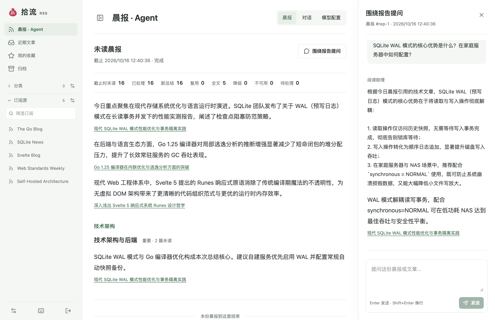
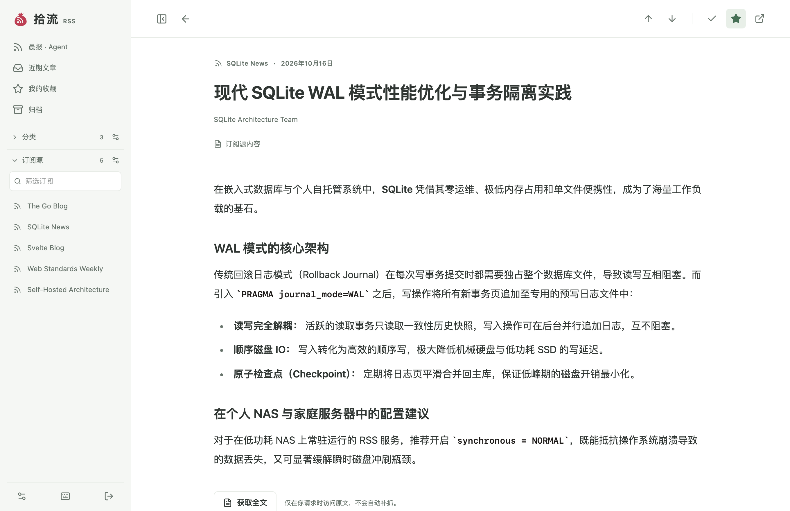
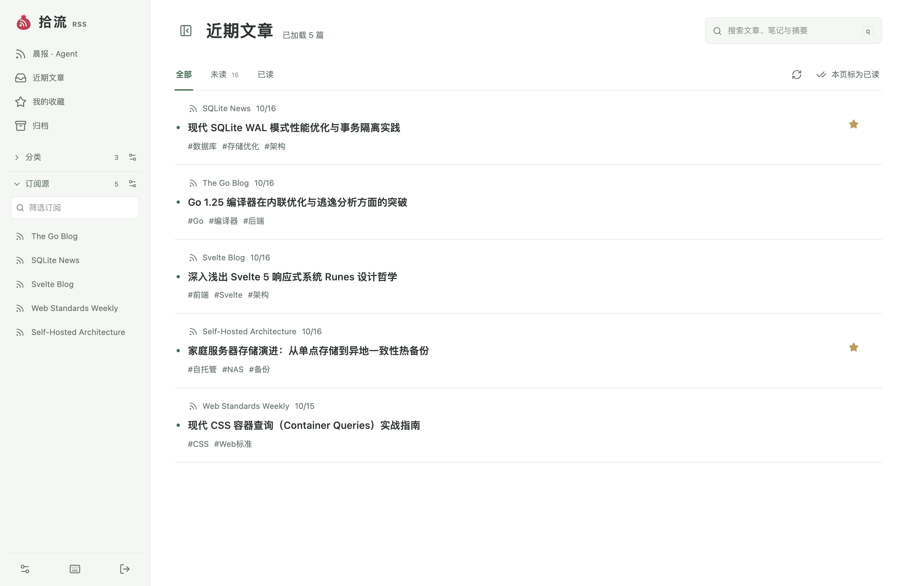

<div align="center">


# 拾流 RSS · Shiliu

**轻量、高效的个人自托管 RSS 阅读器，融合智能晨报与对话式 AI 助手。**

基于 Go + SQLite 单进程与现代 Svelte 5 前端构建，专为家庭服务器和低功耗 NAS 打造，拥有极致轻量的资源开销与稳健的数据生命周期管理。

<p align="center">
  <a href="README.md">English</a> •
  <strong>简体中文</strong>
</p>

<p align="center">
  
</p>

</div>

---

## 核心特性

- **⚡ 轻量单进程架构**：纯 Go 后端直接嵌入预构建的 Svelte 5 静态单页应用（SPA）。无多余外部运行时依赖（生产环境无需 Node.js，无需独立数据库服务），内存占用极低，毫秒级快速启动。
- **☀️ 每日未读晨报**：每天定时对全部未读内容进行全局分析与结构化聚合，按分类、订阅源与重要度生成简明晨报。报告内提供文章精细引用，支持一键定位并阅读系统内正文，返回时自动恢复滚动与报告位置。
- **🤖 内置对话式 AI Agent**：支持针对晨报及文章归档直接展开上下文提问。基于有界词法 RAG，原生兼容 OpenAI API / Chat Completions 规范。具备严格的每日 Token 额度、执行时段与速率控制；未配置时完全静默，零额外开销。
- **📖 专注流畅的阅读体验**：排版简洁清晰，自适应系统明暗主题；支持全套键盘快捷键操作，键位设计避让 Vimium 默认映射，告别阅读时的焦点冲突。
- **🔄 可靠的源更新与健康追踪**：全面支持 RSS 2.0、Atom 及 JSON Feed。支持 HTTP 条件请求（`ETag` / `Last-Modified`）、错峰抖动、指数退避策略，以及支持崩溃恢复的持久化后台任务队列。
- **🧹 精细的数据生命周期**：支持按订阅源配置独立保存与保留策略（例如普通文章正文 90 天自动清理，保留标题、元数据及笔记），星标收藏与长期存档源享受永久豁免。
- **🔍 全文获取与全文检索**：内置一键式正文智能提取引擎与服务端 HTML 安全净化；集成 SQLite FTS5 全文索引，支持中文分词与短语搜索。
- **🚚 无缝迁移与开放标准**：原生支持从 Miniflux 一键无损导入订阅、文章历史、阅读状态与收藏夹；支持标准 OPML 导入导出；提供完整的 OpenAPI 3.1 契约规范。

---

## 界面预览

<div align="center">

### 专注舒适的正文阅读体验


### 简洁高效的订阅与列表视图


</div>

---

## 技术选型

| 分层 | 选用技术 | 说明与考量 |
|---|---|---|
| **后端服务** | Go（标准库 `net/http`） | 简洁的并发模型、极低内存驻留、出色的跨平台静态交叉编译能力 |
| **持久化存储** | SQLite WAL（`modernc.org/sqlite`，`goose`） | 纯 Go 驱动无需 CGO 依赖；支持嵌入式事务版本迁移与数据安全性 |
| **搜索引擎** | SQLite FTS5 | 原生汉字分词与短语检索，正文清理与索引维护处于同一短事务内 |
| **前端框架** | Svelte 5 + SvelteKit + TypeScript | 响应式组件化架构，构建产物为静态资源，通过 `go:embed` 嵌入二进制中 |
| **样式与组件** | Tailwind CSS 4，Lucide 图标 | 统一设计语言与现代排版，流畅的响应式与键盘交互 |
| **API 契约** | OpenAPI 3.1.0（`oapi-codegen`，`openapi-fetch`） | 单一契约源，自动生成强类型的 Go 处理器与前端/Agent 客户端 |
| **正文提取与安全** | `gofeed`，`go-readability`，`bluemonday` | 严格的受控数据摄取、正文提纯与服务端 HTML 净化防注入 |

---

## 快速开始（本地开发）

### 环境要求

- **Go**: 1.27+
- **pnpm**: 11.0.9+（Node.js 运行时由项目 pnpm 本地提供，不影响全局系统环境）

### 本地初始化与运行

1. **安装项目依赖与测试环境**：
   ```sh
   make setup
   ```

2. **初始化本地数据库与凭据**（仅首次运行需要）：
   ```sh
   make init
   ```
   > 系统将自动在 `.local/admin-password` 生成随机初始管理密钥。登录仅需密钥，无需输入用户名。

3. **启动双端热重载开发环境**：
   ```sh
   make dev
   ```
   - 前端界面：**http://127.0.0.1:41002**（Vite 开发服务器，支持热重载）
   - 后端 API：**http://127.0.0.1:41001**
   - 本地端口映射统一固化在 `config/dev.env`。

4. **运行单进程嵌入成品**：
   若需在本机验证完整嵌入前端的单一可执行文件：
   ```sh
   make run
   # 打开 http://127.0.0.1:41001
   ```

---

## 生产环境部署

拾流 RSS 专为 NAS 与家庭服务器设计，推荐使用 **Docker Compose** 配合反向代理（如 Nginx、Caddy 或 Traefik）配置 HTTPS 运行。

### 1. Docker Compose 配置示例

```yaml
# deploy/compose.yaml
name: shiliu-rss

services:
  reader:
    image: ${SHILIU_IMAGE}
    restart: unless-stopped
    read_only: true
    user: "65532:65532"
    cap_drop: [ALL]
    security_opt: [no-new-privileges:true]
    ports:
      - "127.0.0.1:8080:8080"
    volumes:
      - ./data:/data
      - ./backup:/backup
    environment:
      SHILIU_ADDR: ":8080"
      SHILIU_DB: /data/reader.db
      SHILIU_ORIGIN: "https://reader.example.com"
      SHILIU_COOKIE_SECURE: "true"
      SHILIU_BACKUP_DIR: /backup
    tmpfs:
      - /tmp:size=16m,noexec,nosuid,nodev,mode=1777
    healthcheck:
      test: ["CMD", "/reader", "healthcheck"]
      interval: 60s
      timeout: 6s
      retries: 3
```

### 2. 账户初始化与安全配置

在生产环境中，请通过文件挂载初始化管理员凭据，避免敏感密码暴露在终端历史记录中：

```sh
docker compose run --rm --no-deps -T \
  -v /path/to/password-file:/run/secrets/password:ro \
  -e SHILIU_PASSWORD_FILE=/run/secrets/password reader init
```

完整的生产部署、Nginx 反向代理配置、自动化定时热备份及版本升级回滚步骤，详见[部署指南](docs/production.md)。

---

## 快捷键一览

专为高频阅读优化的桌面端快捷键映射（已针对 Vimium 进行按键避让设计）：

| 按键 | 说明 |
|:---:|---|
| `↑` / `↓` | 列表焦点切换 / 正文阅读模式下的上一篇与下一篇 |
| `c` | 展开或收起侧边栏导航 |
| `a` | 切换当前文章已读 / 未读状态 |
| `s` | 切换当前文章收藏 / 星标 |
| `e` | 在新标签页中打开原文链接 |
| `q` | 返回列表并聚焦全局搜索框 |
| `Esc` | 关闭当前浮层 / 关闭设置 / 退出正文阅读返回列表 |

---

## 内置 Agent 配置

在系统「**设置 → Agent 配置**」中可按需配置大语言模型接口：

- **协议支持**：兼容标准 OpenAI API 格式（Chat Completions / Responses）。
- **凭据安全**：API Key 在前端界面仅供提交、不进行任何回显；同时支持通过环境变量 `SHILIU_AGENT_API_KEY_FILE` 指定受保护的密钥文件。
- **定时晨报**：默认每日定时（如 Asia/Shanghai 08:00）对全部未读文章进行汇总提炼。
- **资源与额度**：支持配置每日 Token 预算上限、并发限制与执行时间窗口；未配置时 Agent 处于完全停用状态，不占用任何额外资源。

---

## 验证与代码质量

```sh
make check-generated  # 检查 OpenAPI 契约与 Go / TypeScript 代码生成漂移
make check            # 执行 go vet 及前端 Svelte / TypeScript 类型检查
make test             # 执行带有数据竞争检查 (-race) 的单元与集成测试
make test-web         # 使用 Playwright 运行完整的端到端浏览器自动化套件
make build-linux      # 本机交叉编译适用于 Linux AMD64 的发布级静态二进制
```

---

## 文档索引

更详细的技术细节与系统运维手册可参考 [`docs/`](docs/) 目录：

| 文档分类 | 推荐入口 |
|---|---|
| **文档总览** | [文档索引](docs/README.md)（文档全景导航与阅读建议） |
| **产品与需求** | [产品需求](docs/product.md)、[实施记录](docs/implementation.md) |
| **架构与设计** | [架构设计](docs/architecture.md)、[技术选型](docs/technology.md)、[决策记录](docs/decisions.md) |
| **Agent 与接口** | [Agent 设计](docs/agent-design.md)、[Agent API](docs/agent-api.md)、[OpenAPI 契约](api/openapi.yaml) |
| **部署与运维** | [生产部署](docs/production.md)、[运维与迁移手册](docs/operations.md) |
| **前端架构** | [前端工程说明](web/README.md) |
| **安全准则** | [安全与敏感数据说明](docs/security.md) |
