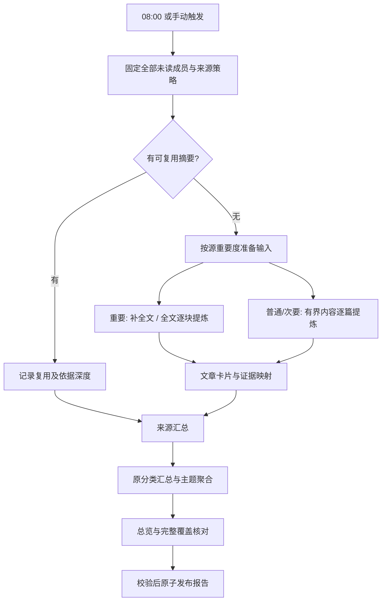

# 内置 Agent 系统设计

日期：2026-10-15。状态：**设计稿，功能尚未实现**。依据 R-19–R-23 与本轮用户回答；原首版的外部 Agent API 是基础能力，不是本方案的实现结果。调研见 [依据与限制](agent-research.md)，具体指令见 [提示词与输出契约](agent-prompts.md)。

## 产品边界

Agent 成为系统内的正式模块，负责每日未读晨报、围绕文章/报告的对话、系统内容查询，以及供外部 Agent 接入的同等能力。仍使用 Go + SQLite + Svelte 静态前端及现有进程。不新增模型运行平台、独立向量服务或权限体系；沿用当前登录/token 入口，不增加角色、scope、文章 ACL 或逐次批准流程。

模型 API 未配置时显示“未配置”，不会排队、补抓、建索引或发起模型请求。配置后可单独开关整个 Agent、晨报计划；停用后取消待执行模型工作，历史对话和报告仍可读。配置缺失不影响阅读器可用性。

第一阶段支持一个活动配置；用同一兼容模型完成提炼、汇总与对话，不要求用户维护多个 Agent。可配置：名称、API base URL、模型名、密钥引用、上下文/单次输出限制、输出模式、晨报时间/时区、日 token/调用上限。密钥走部署环境的 secret 文件或设置中的只写密钥字段；响应只给 `key_configured`，日志和对话不含密钥。密钥处理是配置正确性，不扩展成权限子系统。

兼容基础为 `/chat/completions`。默认 `messages` + 配置的输出上限；对不支持的 temperature 等字段不强行发送。不假设支持 Responses、原生 function tools 或严格 JSON Schema。配置可选 `json_schema / json_object / text_json`；每种均由服务端解析校验，基础 `text_json` 也能运行。连接检查为用户显式操作的小请求；不在每次启动时探测或静默切换收费模型。

## 页面与操作

侧栏增加“Agent”。进入 `/agent` 为最近会话与今日晨报，子入口为“对话 / 报告”；设置里有“Agent 配置”和来源重要度批量编辑。

- 对话：支持新会话、历史会话、消息输入、生成中/取消/失败重试、引用回看；报告可以“围绕这份报告提问”。系统任务/工具结果折叠显示“检索了什么、实际读取多少篇”，不展示模型思维过程。
- 报告：日期列表、今日状态、手动生成、刷新状态、停止、失败处重试；正文可展开原分类/来源，每段内有引用；文末显示覆盖与缺文概况、持续未读数量。详细成员表按需分页，不把数千个链接全部铺开。
- 来源设置：重要 / 普通 / 次要，支持在已有分类里批量调整；默认普通，不凭收藏、文章数或分类名称猜重要性。
- 设置：未配置状态能进入配置；配置保存后启用开关可见；任务时间默认 Asia/Shanghai 08:00，可修改；模型失败单独显示，不伪装为源抓取失败。

桌面和手机同一逻辑。聊天输入时原阅读快捷键不触发；Enter 发送、Shift+Enter 换行，中文组合输入不误发送，Tab 保留控件操作。报告引用点击打开现有内部文章阅读页，保留返回报告/会话的位置。生成/浏览报告和检索不改变 read/favorite/note/tag；用户主动打开引用文章沿用现有阅读页规则。

## 晨报的集合与时间

默认每天北京时间 08:00 触发；**截止点是实际创建成员快照的数据库时刻**，正常运行在 08:00 后一个调度周期内开始。不是“过去 24 小时新文章”：所有当时未读且未 removed 的记录都属于本次集合，包括归档、暂停源的既有未读。源常规调度独立，不在 08:00 强制刷新所有源。

创建 `report_run` 时在短写事务中用 `INSERT ... SELECT` 固定所有成员的 article ID、feed/category ID/名称、重要度、首次收录时间及当时内容 hash/状态；同时存 cutoff、changes 高水位和总量。不是边翻可变列表边猜集合。提交后再做网络/模型工作。

成员固定，正文不永久冻结：读取前核对有效期/当前 hash，把实际使用的 hash 和取得时间记录到成员上。补抓/内容更新可能晚于 cutoff，报告标明“未读名单截止 X，内容处理至 Y”。正文已到期、已删除、已变更都明确记录；重试不悄悄改成另一个未读集合。处理中用户标已读不移出本报告，新文章留待下次。分类/重要度在本轮按快照使用，后续调整影响下轮。

调度以 `schedule_id + local_date` 唯一；重复 tick/重启只产生一个定时运行。手动重试沿用 run，手动重新生成创建显式 revision 并链接旧版。时区用 IANA zone，截止时间存 UTC，展示本地时间。掉线恢复只补**最近一个已错过时点**的报告，快照取恢复时状态并注明延迟，不伪造历史未读快照，不为离线多日补一串报告。启用计划从下一个时点开始，立即生成由按钮触发。

08:00 是开始生成时间，不能在未知文章数/模型/站点延迟下承诺此时已完成。默认本轮最长 30 分钟，到期发表明确的部分报告，已有工作可续作；这是一项可配置工程初值，需本机验收。没有未读时直接生成 0 篇报告，不调用模型。

## 重要度与输入深度

| 重要度 | 输入与处理 | 汇报要求 |
|---|---|---|
| 重要 high，权重 4 | 优先用仍有效的已取得全文；无全文时按下面策略请求网页全文；按结构分块，所有正文块都成功提炼后才能记为全文处理 | 每篇有独立可展开要点，关键结论/数字/限制保留；缺全文、超长未完成等逐条说明 |
| 普通 normal，权重 2 | 标题 + 已有来源摘要；没有独立摘要字段时取有效源内容前 3,000 个 Unicode 字符，段落边界截断 | 每篇生成短卡片；标明摘要/截取依据，不能声称读过全文 |
| 次要 low，权重 1 | 标题 + 已有来源内容前 500 个 Unicode 字符；无可用内容则仅标题 | 允许多篇合并趋势/主题，保留成员映射；不能从标题推测未给出的结果 |

3,000/500 字符为可配置的输入预算初值，不是经过质量测量的最佳值。源内容不区分摘要/全文时不以长度自动宣称完整。不同深度使用不同 cache key；把来源升为重要后，不能用旧的标题卡片冒充全文摘要。

重要源全文策略：

1. 复用仍有效 fulltext；源内容已清理/到期的文章只用已保留摘要和标题，**不借每天晨报反复复活正文**。收藏/长期保存仍遵循现有规则，不恢复已丢失内容。
2. 对尚在内容有效期、未曾清理且缺少 fulltext 的文章，复用现有全文任务、网络限制、站点冷却和提取器，自动发起一次完整尝试周期；失败可按既有三次退避，不在次日重新无限尝试。显式“重新尝试”仍可用。
3. 任务记录 `reason=morning_report` 和本轮 ID。自动补抓不重置原有首次收录/保留期限；过期时停止，不把原本 90 天正文变成无限续期。用户/外部 Agent 显式重新获取仍遵循原 R-10。
4. 失败/限流/未完成时用仍有效源内容或旧摘要降级，标明原因与实际深度；重要文章缺文使 report 为 partial，不能显示“全部全文已总结”。

## 大数量处理与聚合

所有成员先分配状态，使用稳定 ID 排序；重要源优先，同时按来源轮转，防止一个大源饿死其他源。小文章按输入 token 预算打包，一批最多 20 篇；重要长文单篇分块（初始目标 1,200 tokens、最多约 10% 重叠，段落/节边界优先），遍历所有块后合并文章卡片。分块清单与处理完成位持久化；输入过大时继续拆分，不静默截断重要文章。

第一阶段按“原分类 → 来源”保留结构：分类按最高源重要度、加权未读量、稳定 ID 排；分类内来源按重要度优先，再按未读量降序。来源下可合并重复主题；分类总览综合其下来源，仍保留来源出处和成员映射。跨分类主题可在总览关联，不能改写用户分类。

展示篇幅按 `w(source) × log2(1 + unread_count)` 分配，并设置每个非空来源最低一条汇总、重要文章独立详情入口。数量增长提高篇幅但不过度挤占小而重要的源。默认分类正文总预算约 4,000 中文字，超多来源时增加分页/展开层；这不是排除成员的阈值，完整成员与摘要另存，不要求一屏列完。

来源汇总超过单次上下文时按稳定 batch 汇总后再归并，层数与输入/输出均有上限。每条派生结论追踪至原始文章/证据 ID，层间不能只传没有出处的自由文本。跨源重复报道可以合并叙述，但每篇成员依然存在，代表段落可引用多篇；不把多条报道说成多项独立事件。

## 摘要复用与覆盖账本

持久卡片 key 至少含 `article_id + actual_basis_hash + depth + input_policy_version + prompt_version + schema_version + model_config_fingerprint`。fingerprint 不含密钥；来源分类变化只重建聚合，内容未变且深度足够可复用卡片。连续未读仍入当天成员统计，标记“持续未读/摘要复用”；不重复做文章级调用。成员/摘要结构 hash 没变时，来源和分类层也可复用，日期与数量由系统重绘。

日期、阅读状态、分类名不混入全文摘要 key，避免每日失效。正文变了、输入深度升级、提示词/schema/model 变更则按需重做；接口失败不抹去已生成卡片。正文已经清理时可使用保留的旧卡片，但标“历史摘要，当前原文不可核验”，不声称此次读了全文。

成员处理状态互斥：`summarized / reused / fallback / unavailable / pending`。另存实际依据 `fulltext / feed_excerpt / title / saved_summary` 与重要源的完整块覆盖。`sum(states) = snapshot_total` 必须成立；“纳入统计”“已按策略处理”“本次全文读取”“复用历史全文摘要”是不同数字。

- `complete`：每个成员有符合其深度策略的卡片/有效复用，所有重要文章具完整全文依据，且聚合与引用校验通过。
- `partial`：有缺文、降级、预算/时限未完成成员；仍发布可用报告，列出每项数量及可展开清单。
- `failed`：无法形成可信报告，例如快照失败或所有生成内容校验失败；显示失败原因，不造一份成功报告。
- `cancelled`：用户取消；已有卡片可供下一次复用，不把取消的正文当正式晨报。

仅标题的次要源正常按其策略处理仍可 complete；重要源的标题回退则一定 partial。程序确认的是处理与引用结构完整，不保证模型理解无遗漏。

## 对话与 RAG

晨报的全集遍历和对话的证据检索分别实现。问“所有未读的趋势”触发/读取完整报告；不能把 top-k 搜索当全库统计。数量、来源健康、日期范围、报告状态来自业务查询的确定结果，禁止模型靠检索结果估算。

第一阶段为**词法 RAG + 层次摘要 + 必要原文读取**：

1. 明确查询范围（默认全部仍存在文章，含归档；可指定未读、分类、来源、日期）。带报告的会话默认指向该报告成员；用户扩大范围时明确标示。
2. 根据问题生成至多 3 个字面检索短语，映射现有中文分词；不接受模型提供 SQL/FTS 语法。宽问题先用分类/来源摘要缩小范围。
3. 复用文章 FTS 找候选（最多 100 篇），从有效内容按段落形成候选片段并词法排序；首阶段按需分块，不要求先复制全库。索引中标题/源/节标题辅助定位，原片段仍与附加元信息分开。
4. 每轮最多给模型 12 个片段、每篇最多 3 段，按实际上下文预算再裁减；命中后可读取相邻段、完整文章或对应卡片。文章太长时逐块读取并披露覆盖，不能把截取结果称作完整阅读。
5. 最多 6 个检索/读取步骤，一次只运行已定义动作；结束、超预算或无新增证据就回答/说明不足。工具是 search、read_articles、counts、source_health、read_report 等业务能力，模型不用自由 SQL、shell 或任意 URL 请求。
6. 输出每个事实段的证据 ID，系统校验映射后渲染；答案说明范围、原文/摘要依据及必要缺口。无证据就说没有找到，不能凭模型常识冒充系统文章。

旧对话只保留有限最近轮次与可追溯的会话提要，不能每次重传整个历史。摘要中的事实仍要重新读取对应有效证据，过期原文不能从历史上下文“漏回”。用户聊天文本和已发布的释义摘要保留，原始工具片段只短期保存/到期移除。

**可选语义增强阶段**：另配 embedding 模型时才启用，Chat Completions 配置不表示有 embedding 能力。段落块预留 `article_id, basis_hash, heading, ordinal, expires_at, embedding_model_version`；在支持当前构建和清理事务的嵌入式方案中比较候选，先做小型原型与精确扫描基线，不能无界扫 10 万篇向量。词法 top-N 与向量 top-N 经 RRF `sum(1/(60+rank))` 融合，再可选重排；参数为初值，经金标准检索集决定。索引未建完/模型不可用则回退词法并显示状态，不阻断对话或晨报。

向量不是晨报覆盖条件；持续更新只处理 hash 变化和未索引内容，版本切换支持重建与旧索引清理。模型生成 contextualization 是后续实验，第一阶段先添加确定的标题/来源/节标题，避免为每个片段额外付费。

## 引用与输出

模型只返回结构化块和服务端提供的 evidence ID，不能输出可执行 HTML 或自行构造 URL。服务端验证 evidence 属于本次读取集合、article ID/hash 对应、引用段的类型/长度/数量合法。派生卡片/报告引用继续追溯文章 ID，不把模型生成的证据标成原文。

系统将事实块渲染为“该来源报道……”，段落后附文章标题链接，引用紧邻对应段落；多篇支持时给多个链接。内部相对链接为 `/?scope=all&article=<encoded-id>`，从受信的配置入口地址可生成绝对内部 URL，绝不使用源站 URL 替代。源站链接仍在文章阅读页。

报告头的日期、范围、计数、状态及来源结构由程序生成，不让模型编数字。文章已清理时链接仍打开其标题/元数据/整理成果；removed 则显示不可用状态，不跳转源站掩盖失效。仅 URL/ID 检查不能确认语义支持，需另有质量验收。

结构化输出失败、未知引用、空引用事实、截断或拒答最多有一次受预算约束的格式重试；再次失败回退确定的标题清单/局部报告，标明缺口，不能删除未知引用后把原结论当成功发布。

## 持久化与执行模块

| 模块 / 数据 | 职责 |
|---|---|
| `internal/agent`（新） | 固定工作流、检索循环、模型适配、prompt/schema、token/调用预算；模型请求和 HTML 解析在事务外 |
| `internal/app/agent_*.go`（新） | 配置、源重要度、成员快照、运行状态、卡片/报告/会话及预算账本；浏览器/外部接入共用 |
| `agent_settings` | 单活动配置、启停、密钥引用、schedule/timezone、版本；对外不回传密钥 |
| `feeds.importance` | high/normal/low，默认 normal；变更记录版本/changes，不改变保存策略 |
| `agent_runs` / `agent_steps` | kind、schedule/date/revision、cutoff、配置/提示词版本、状态、续租 fencing、步骤输入 hash、尝试/结果/用量、取消与恢复点；已发布报告作为run的结构化结果，不另建报告内容表 |
| `report_members` | 固定集合、源/分类/重要度快照、实际依据 hash、深度/状态/缺口、卡片引用；唯一 `(run_id, article_id)` |
| 复用 `artifacts` | 内容 hash 对应的系统释义卡片、证据来源与生成版本；使用稳定external_id和独立kind，索引只收释义文字，不重复存一张卡片表 |
| `agent_conversations` / `agent_messages` | 会话、消息、关联报告、结构化回答与引用；用户消息去重，生成失败可重试 |
| `agent_steps` 的用量字段 | 请求前预留、完成后结算、超时未知用量、计费日（按配置时区）；短事务汇总当日预留/实耗，不另建费用子系统 |
| 临时证据 | 默认在内存中按需从有效原文构造；确需恢复的scratch字段带到期时间，终态/清理时删除，不建永久原文缓存 |

首阶段新增六张业务表：settings、runs、steps、report_members、conversations、messages；卡片复用artifacts、报告复用run结果、预算复用step记录，避免为每个概念另造一个子系统。复用 store 的迁移/备份，不直写 SQLite 私有结构。schema 从当前 v2 向前迁移，默认禁用并填 normal；老 token、文章、阅读/收藏状态、摘要保持可访问。模型配置失效只影响 Agent。报告/会话/卡片的保存与 changes 在同一个短事务提交。

执行器与现有 feed/fulltext 明确分派；第一阶段新增独立 Agent 持久队列与单个模型执行槽，避免当前非 feed 分支误执行 fulltext。自动补全文仍进入原网络任务槽，低优先级轮转，不改变源定期更新的 SLA。模型连接与源站请求使用不同客户端/超时及限流域。

租约初值 120 秒、每 30 秒续租；提交必须携带匹配的递增 fencing token，丢失租约取消请求并拒绝旧 worker 写结果。步骤按输入 hash 幂等；重启只续未完成步骤，不重复保存报告。远程模型调用不能承诺 exactly-once：网络已发送但结果未落库时恢复可能重复收费，记录 `usage_unknown` 并保守计入预算，不伪称绝无重复调用。

## 预算、失败与存储

可配置日 token/调用上限；金额预算仅在用户配置可信输入/输出单价时估算，不因缺价格阻止用户启用，也不猜兼容服务收费。初值：模型并发 1、每日报价无关总 token 上限 1,000,000、模型请求上限 200、单次超时 90 秒、晨报运行窗口 30 分钟；这些需测量后调优，所有重试/格式修复/对话都纳入同一日账本。

请求前原子预留估算输入 + 最大输出，完成结算 actual usage；没有 usage 就用保守上限；有未知 reasoning token 的服务也按其合同/上限处理。未知 tokenizer 采用保守 UTF-8 字节上界加消息开销，响应 context overflow 时拆小输入重试且计费照记；不声称通用精确 token 统计。达到预算时复用缓存和程序标题清单，报告标 partial，保留可继续工作；手动继续也不能静默绕过日上限。

429/5xx/可恢复网络错误按 Retry-After 或持久退避，最多三次；400 字段错误、401/403 配置错误不循环重试；格式错误独立最多一次修复，仍计入总请求预算。取消、停用或配置版本改变在步骤边界检查，在途旧配置响应不继续发布。调度/模型故障不使 reader health 变为整体不可用，Agent 状态单独报告。

生命周期同时覆盖原始片段、引用摘抄、持久任务输入、索引/向量与工具消息：每次读取/构造模型请求时按有效期过滤；物理清理同事务移除或更新派生检索数据。不通过长期保存 prompt/response 原件绕过 90 天。永久报告/卡片只保存释义摘要、ID/hash、处理统计；原文长引用不作为摘要保存。原始证据/调试输入默认不持久化，确需恢复时只短期保存且截止不晚于正文期限；文章清理后历史报告仍可读其释义，明确“原文已清理”。

## API 草案

下面是待实现契约，**当前 OpenAPI 尚无这些 endpoint**；实施时先扩展同一 `api/openapi.yaml` 并生成 Go/TS，不维护一套旁路 API。复用已有登录/token，不新增 scopes、权限矩阵或审批；Agent接口不再逐项细拆权限。配置管理沿用现有设置入口。

| Endpoint（基础 `/api/v1`） | 用途 |
|---|---|
| `GET/PUT /agent/settings`，`POST /agent/connection-checks` | 查询/保存配置，显式检查；使用 version，敏感字段只写 |
| `PATCH /feeds/{id}` / 批量设置入口 | 增补 importance，不改变原源保存策略 |
| `POST /agent/report-runs` | `mode=scheduled/manual`，服务端控制 schedule/date；带 Idempotency-Key，202 返回 run ID |
| `GET /agent/runs/{id}` / `POST /agent/runs/{id}/cancel` / `POST .../retry` | 进度、预算、错误、取消/续作；重复操作有稳定结果 |
| `GET /agent/reports` / `GET /agent/reports/{id}` / `GET .../members` | 报告与固定成员分页，返回服务端生成的内部引用 |
| `POST/GET /agent/conversations` / `GET /agent/conversations/{id}` | 建会话/会话列表与消息分页，可关联 report ID |
| `POST /agent/conversations/{id}/messages` | 接收 user 消息，Idempotency-Key；202 返回消息/run ID，断线不重复消息 |
| `POST /agent/queries` | 外部无状态查询，复用相同检索/回答管线，202 + run ID；不迫使外部保存对话 |
| `POST /agent/reports` | 外部 Agent 写回结构化报告，必须关联系统生成的成员快照/run、符合相同 schema 与引用/覆盖校验；外部声明的全文阅读与本系统实际读取分别记录 |

run/消息使用短请求 + 进度轮询，首阶段不依赖长连接，避开现有 HTTP 30 秒 WriteTimeout；后续需要时才加 SSE，仍以持久结果为准。未配置/停用时生成入口返回稳定 `agent_disabled` 错误，历史读取可用。引用和表格不输出订阅私密 URL。

## 实施顺序与可观察验收

每阶段先补契约/迁移，再实现同一业务层及网页，检查实际结果后进入下一阶段。以下是计划，尚未运行。

| 阶段 | 目标 / 模块 | 验收方法 | 本阶段未处理 |
|---|---|---|---|
| P0 设计与契约样本 | R-19–23；本文、调研、提示词/schema、产品/决策同步 | 用户要求逐项可追溯；schema/例子解析、跨文档一致性检查 | 不调用实际模型、不声称功能完成 |
| P1 配置与持久基础 | settings、importance、agent runs/steps/usage、适配器、迁移/API | 未配置零调用；无工具/JSON模式也能经本机假模型工作；v2升级、错误/限流/取消/租约/预算竞争 | 暂不发布完整晨报/对话 UI |
| P2 晨报闭环 | 快照、全文策略、分块/卡片/聚合/报告、计划、报告网页 | 可控时钟08:00只生成一次；全未读无遗漏；读状态竞争、断电续作、持续未读不重复提炼、内部引用 | 语义向量与高级对话后置 |
| P3 对话与外部接入 | RAG、会话/消息/查询/外部报告、Agent网页 | 问答/数字/报告追问，无答案/冲突/指令注入，断线幂等，手机/键盘/内部引用及正文到期 | embedding/rerank为独立增强，不影响完整交付 |
| P4 本机质量与规模 | 合成金标准、2,000/10,000未读、长文、失败恢复/清理 | 格式/ID/覆盖程序校验100%；语义引用与事实/遗漏抽检；记录耗时/内存/调用/token，不把设计预算写成实测 | 真实模型质量须用户配置后才能测，NAS不做测试环境 |

第一阶段不包含 NAS 部署/真实数据全量迁移、系统外推送、自动标已读、任意配置修改工具、多 Agent 协作、自动选模型、默认全库 embedding 或新的权限设计。
