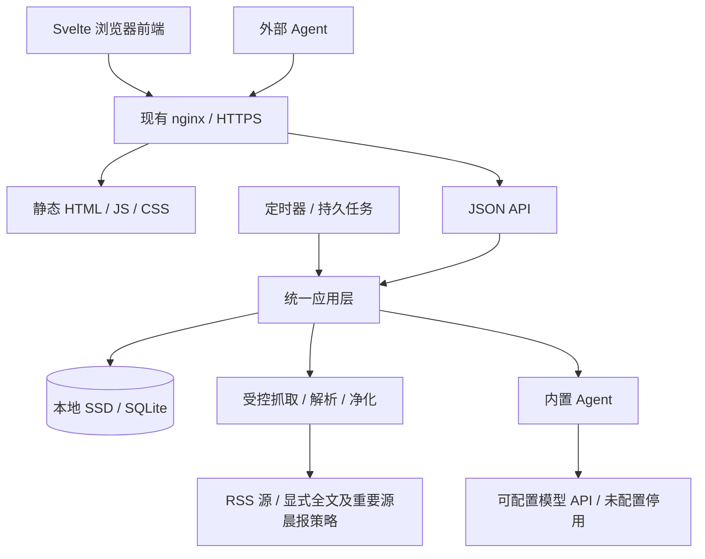

# 首版架构

日期：2026-10-15。状态：首版实现与本机验证已完成，2026-10-16已部署NAS并切换Miniflux，部署步骤见production.md。遵守 [产品基线](product.md)；技术组合与取舍见 [技术选型](technology.md)。本文件规定模块边界和关键不变量，具体 SQL 在 migrations/，契约在 api/openapi.yaml，启动命令见 README/Makefile。

**本次架构增补：** R-19–R-23 将 Agent 从外部 API 调用方扩展为系统内置模块。完整新架构见 [Agent 系统设计](agent-design.md)，配置、晨报、对话与 SQL/OpenAPI 均已实现。下列首版的身份/scope描述记录既有实现，本次不据此新增 Agent 权限系统。

## 一个进程，三类入口

静态资源服务、API、后台工作在同一个 Go 进程。Svelte 页面在浏览器运行，与 Agent 调用同一 API；应用层负责事务、权限和产品规则，存储层负责 SQL，抓取适配器负责外部输入。NAS 没有 SvelteKit/Node 服务进程。

当前代码采用 `cmd/reader`、`internal/{app,store,http,fetch,jobs,importer,agent}`、`migrations`、`api`和 `web`；测试随相应模块维护，目录按需要创建，不预建空目录或为每个实体制造一套抽象。领域类型与规则先放 app，遇到实际复用再提取。时钟、网络和事务边界可注入，便于验证重启、退避与到期行为。

`web/` 是 Svelte 5 + TypeScript + SvelteKit 工程，Tailwind CSS 4 编译样式，按需采用 shadcn-svelte。路由包括列表、阅读、归档、源设置与健康页；状态在组件或相关页面间管理，不复制服务端的过期/授权规则。后台响应给出正文状态和期限，前端据此显示并在期限到达或页面重新激活时重新核对。导航请求可取消，乐观已读/收藏支持失败回滚。

构建使用 adapter-static 生成 `200.html` fallback 及带内容 hash 的静态资源，嵌入 Go 产物。Go 仅对页面路由回退到入口，`/api`、健康接口和缺失静态资源保持正确的 404；深链接刷新可恢复路由。静态资源可长期缓存，入口需要重新验证，私人文章 API 使用 no-store；首版没有 service worker、IndexedDB 正文缓存或离线同步。文章只在后台净化后插入页面，Tailwind prose 样式不能替代 HTML 安全处理。

## 数据模型与写入

| 数据组 | 保存内容与主要约束 |
|---|---|
| feeds / categories | 订阅、分类、手动暂停、按源更新/保存/隐藏策略、HTTP 校验头、最近尝试/成功与下次时间 |
| articles / identities | 稳定文章 ID、来源标识及别名、标题/链接/时间、已读/收藏、版本；来源内去重 |
| article_content | feed 正文与显式获取的 fulltext 分开，保存 HTML、取得时间、hash、可用状态与保留时钟；不存网页原始快照 |
| notes / tags / artifacts | 个人笔记、标签、Agent 摘要/分析；产物记录生成者、类型、依据内容 hash 与时间 |
| search | 可重建 FTS5 索引，按标题/链接/feed 正文/fulltext/整理成果区分列，可分别约束来源内容截止时间 |
| jobs | 任务类型、对象、到期时间、状态、尝试次数、租约与错误类别；同对象同类型活动任务唯一 |
| changes / idempotency | 单调递增变更序号与对象版本；请求去重键、请求 hash、结果标识；均不复制文章正文 |
| account / sessions / tokens | 单一账户、密码 hash、会话、独立用途 token 的 hash/权限/撤销状态 |
| imports | 源实例、原记录 ID、映射与导入批次；固定迁入时间及保护期限，重试不能重置 |

SQLite 使用 WAL、每连接 `foreign_keys=ON`、`busy_timeout=5000`、`synchronous=FULL`。应用启动时核验实际设置，不能只在某一条连接运行一次 PRAGMA。初始写池最多 1 个连接、读池最多 2 个；所有业务写入经统一短事务执行，后台批量入库分批提交。网络、HTML 处理和等待都在事务之外。

写操作把业务状态、索引、变更记录和相关任务结果一起提交。禁止读取正文后在无版本校验的情况下迟到写回旧副本。查询必须分页、按需取正文，游标关闭及时，避免长读事务阻碍 WAL 检查点。数据库迁移由单实例持有应用锁执行；已发布迁移不可改写，升级前一致性备份，无法安全迁移时停止启动并报错。

文章去重优先源内稳定 GUID/Atom ID，其次保守规范化 URL；缺失时使用明确记录的后备指纹，不以正文变化重置身份。维护身份别名以匹配迁入旧文章，不跨源自动合并。不能随意剥离 URL 查询参数，不能把有相同标题的文章直接判成同一篇；缺失身份或冲突在源健康中可诊断。

## 自动检查和恢复

默认检查间隔 **5 小时，±1 小时抖动**，每次算出后持久化 `next_check_at`。允许按源设置；首次新增源立即排队，由全局/站点并发限制逐个处理；后续检查通过持久抖动错开。全局网络并发 2，同站点 1（优先按可注册域名分组），全文提取并发 1。源校验使用 ETag/Last-Modified；304 计作成功，解析失败不能更新成功状态或保存会阻止重试的校验头。

调度器按最早到期时间睡眠，配置变更或手动任务唤醒；最多 5 分钟做一次低成本重核以应对时钟调整，不写空闲心跳。重启时从数据库恢复待办和过期租约，不把“本次进程没有收到通知”等同于没有工作。错过多轮时只补一次当前检查，避免重启触发历史轮次风暴。

任务状态为 queued → running → succeeded / waiting_retry / failed。用原子领取与租约拥有者校验防止重复提交；租约初始 2 分钟，网络请求最长 30 秒、有限解析工作必须在租约内结束或先续租。旧执行者失去租约后不能提交结果。持久化任务语义是至少执行一次，靠去重与幂等提交得到一次有效结果，不承诺网络只请求一次。

源检查暂时失败后按约 15 分钟、1 小时、4 小时、6 小时退避，加小幅抖动，之后仍每 6 小时尝试；遵守更晚的 Retry-After。解析错误、404 等保留错误并低频重试，只有用户动作才暂停源。显式全文任务最多自动尝试 3 次，之后显示失败供手动重试。手动刷新合并同对象活动任务，不能绕过站点限流。

每次出站请求限定 HTTP(S)、总时限、重定向次数和解压后体积（初始 feed/网页各 8 MiB），正文提取限定节点数，超限作为可见失败。连接目标和每次重定向都核对地址；默认不访问私网/回环，确需内网 RSS 服务时按源允许明确主机，不通过订阅内容扩大访问权限。只把凭据发给配置的源，不随跨站重定向转发。私密 URL、正文和认证头不进日志。

健康页展示最近尝试/成功、下次时间、失败分类和到期任务积压；readiness 检查数据库及调度器是否正常推进，单个坏源不让整个应用失去可用性。日志记录必要的错误码/对象 ID，源状态用覆盖更新和有限历史保存，不长期堆积每次成功抓取流水。

## 隐藏、清正文和重新获取

1. **隐藏是查询规则。** 收藏豁免；已读用明确的 read_at + 7 天，未读用 first_seen_at + 30 天，可按源调整。不通过每日任务伪造已读或删除记录；恢复未读仍使用原首次收录时间。
2. **清理是持久事务。** 普通源初始内容的截止为 first_seen_at + 90 天；已清理后显式重新取得的 fulltext 从本次成功取得起另保留 90 天。迁入内容另取与 imported_at + 30 天的较晚值。首次全文补抓不借机改写 first_seen_at，普通轮询也不能延长期限。收藏/长期源保护当前内容，不保护未取得的正文。
3. **留存结果分开保存。** 正文/来源摘要清理时同步移除其衍生文本缓存和索引列，保留标题、URL、笔记、标签、Agent 产物；记录 purged 状态、依据 hash 和原因。hash 不作为正文可恢复的保证。
4. **防止自动填回。** 普通轮询可更新仍在期限内的源内容，但不刷新保留时钟；已 purged 的内容不因重新出现在 feed 中恢复。显式获取成功才写新 fulltext 及新时钟；失败保留现有摘要/全文。
5. **处理并发。** 清理、收藏与保存策略修改在提交时重读有效策略；抓取提交核对内容/策略版本，不能把收藏保护的数据误删或把迟到的旧正文填回。

清理任务默认每天一轮，分批最多 100 条，提供最近及下一次执行状态；页面/API 到期后立即按有效策略隐藏过期正文，持久清理正常应在 24 小时内完成，全文搜索同样过滤到期字段，不能靠未清索引返回正文命中。首轮和保存策略变更有数量预览。实现时需测试页面、API、搜索和索引的一致边界，不能仅测试 NULL 字段。

清理是应用层内容删除与检索不可见，不是取证级擦除。WAL 检查点、索引段合并与空间回收定量执行，空间可供复用，不每删一篇就全库 VACUUM；备份中的旧正文按备份轮换期退出。重新净化与索引重建只能读取仍被策略允许保存的内容，不能从旧备份偷偷恢复过期正文。

## API 与 Agent

OpenAPI 3.1.0 为契约源；用 oapi-codegen 生成 Go 类型和标准 HTTP 严格处理器，手写适配器调用应用层；用 openapi-typescript / openapi-fetch 生成前端类型并发请求。业务校验、scope、CSRF 与错误映射显式实现；生成代码不会替代这些检查。首版提供 `/api/v1`，所有能力有稳定 operationId、成功/失败示例和界限说明。

| 接口组（实现时细化契约） | 规则 |
|---|---|
| articles / feeds / search | 查询近期、归档或全部，明确 body_state、来源、版本与有效截止；默认分页 50、最大 200，正文按需请求 |
| changes | 单调整数 seq（对外字符串）增量游标；只存对象 ID、变更类型和版本，不存旧正文 |
| articles/{id}/fulltext-jobs | 显式 POST，202 返回任务 ID；GET jobs/{id} 看状态；相同活动任务合并 |
| articles/{id}/artifacts | 写摘要/分析，依据内容 hash、生成者由 token 身份绑定，模型等额外元数据可带但不当作可信身份 |
| notes / tags / read-state / favorites | 网页与授权 API 的操作共用事务；若某 token 未获相应 scope 则拒绝 |
| retention-preview / health | 登录用户看清理影响和运行状态；普通 Agent token 不默认拥有策略管理权限 |

稳定文章 ID 对外作为字符串，数据库内部可用不复用的整数主键。文章列表按 `(COALESCE(published_at,first_seen_at),id)` 倒序做 keyset 分页，优先发布时间；缺失时用收录时间，相同时间按ID倒序。游标带published版本，旧收录时间游标返回400并重新从首页读取；时间范围筛选仍基于first_seen_at。Feed接口unread_count统计全部未读含隐藏归档、排除removed，不受文章列表分页和筛选影响；ArticlePage.unread_count按当前范围/源/分类/收藏/搜索/收录日期统计，忽略阅读标签与分页，并与该响应列表共用只读快照；Agent 批量同步先取得变更高水位、按稳定 ID 导出初始集合，再追 changes，允许重复处理但不因新文章插入漏项。changes 包含正文清理、内容更新和整理状态变更；纯时间流逝造成的日常隐藏不生成海量变更，增量消费范围始终包含归档，由截止时间表达可见性。普通搜索分页不承诺冻结可变排名快照。

变更日志首版保留紧凑元数据，未来若压缩须明确 cursor 失效并要求全量重新同步，不能无声跳过。API 请求不跨分页持有数据库事务。写回用 Idempotency-Key + token 身份 + 操作组成唯一键，保存请求 hash 与结果引用；同键不同内容返回 409。摘要写入另有调用方稳定 external_id，防止重试窗口之后重复产物；任务重复由活动唯一约束合并。幂等键至少保留 30 天，此期限写入契约。

上述普通分页/changes不冻结未读状态。晨报需短事务一次固定成员，再在事务外读取有效内容、处理模型；新文章/已读/分类变更不悄悄改变当轮集合。新报告/会话、内部引用、独立模型执行槽、预算账本与生命周期边界按 [Agent设计](agent-design.md) 实施。

编辑采用 ETag/If-Match 或显式 version，过期版本返回 412；摘要依赖的内容 hash 已变化时返回 409，并让调用方重新获取依据。正文已清理时仍可显示旧摘要及其 hash，但不谎称原文仍在。错误使用 `application/problem+json`，有稳定 code、request_id 和可重试提示；不用 HTTP 200 包装所有错误。

scope 至少区分 articles:read、artifacts:write、fulltext:request、reading:write；只有本人管理账号/token/保存策略。token 以高熵随机值生成，明文只展示一次，库中保存 hash、scope、创建/撤销时间；不采用难撤销的长期 JWT。token 验证和业务事务之间处理撤销竞态，避免长期权限缓存。

本人使用密码登录，Argon2id hash；会话为可撤销随机 cookie（HttpOnly、Secure、SameSite），有超时、CSRF 和登录限速。密码哈希参数先在本机测定保守值，部署后按正常登录延迟观察，不依靠大量并行哈希。nginx 提供 HTTPS，受信代理范围明确。文章 HTML 净化后才允许 Svelte 按 HTML 插入，普通字段默认转义；Agent 接口将文章标识为外部资料，文章内容无权调整系统配置。浏览器使用 cookie，不把 Agent token 放到 localStorage。

## Miniflux 迁移

选择**版本适配的只读 PostgreSQL 一致快照导出 → 流式导入新的 SQLite**。旧实例 2.3.0 的实际 schema 在实施时核验；不依赖 OPML 完成文章迁移，也不把网页 API 多次分页误认为一致快照。API 作为抽样核对和订阅交换的辅助，导出在 `REPEATABLE READ READ ONLY` 事务中读取所需列；脚本经 SSH stdin，数据流到执行端，不在 NAS 留中间 JSON/SQL 转储。

保留源实例与原主键、旧 hash、状态及可用时间，首次导入源默认普通保存；显式 disabled 保留，累计错误不能映射成人工暂停。已有抓取/认证/重写等源配置先列兼容情况，不能静默丢掉会影响抓取的设置；不兼容项进入迁移差异报告，凭据按敏感配置单独传输。

first_seen_at 优先源系统 created_at；确实缺失时用固定导入时间并记 provenance=estimated，不拿 published_at 冒充收录时间。已读却没有可靠 read_at 时，用首次导入时间作为隐藏计时锚点，保留 read_at_unknown 标识；不能把 changed_at 直接冒充已读时间。旧系统 removed 状态若仍存在于导出范围，独立标注并放归档，不强行改成未读；具体可恢复字段计入对账。

以 `(source_instance,entity_type,source_id)` 去重，重跑同批不刷新 imported_at 或 30 天保护期。同步已有身份别名，使后续正常 RSS 轮询能匹配迁入条目；旧 ID 与新 GUID/URL 的映射冲突必须报告。迁移后正文统一净化并建立索引。

先预览再导入，核对分类、订阅、文章、已读、收藏、关联、样本内容、时间兜底和不兼容配置；再运行重复导入与真实 feed 重抓去重验证。旧系统在演练期间照常运行；正式切换再安排稳定窗口/最终差量核对，未对齐期间不把新库当成唯一权威。此前阶段仅设计；后续已获授权并完成真实全量迁移，通用切换与差异处理见production.md。

## 本机开发与 NAS 部署

| 阶段 | 执行位置与产物 |
|---|---|
| 开发 | 本机 Go API 与 Vite 开发服务器；本机 SQLite，开发代理 `/api` 到 Go，使用脱敏/合成数据 |
| 测试 | 本机 Go 集成测试、svelte-check 和 Playwright；故障、重启、清理、导入和恢复演练均用本机测试库 |
| 构建 | 本机 pnpm 静态构建，再 Go 交叉编译 `linux/amd64`、`GOAMD64=v1`、`CGO_ENABLED=0`；本机打包镜像 |
| 成品验证 | 本机 Linux 容器/虚拟机验证实际成品；Mac 原生测试不能代替 Linux 运行验证，AMD64 模拟运行不能代替 J1900 功耗实测 |
| 部署 | NAS 接收固定版本镜像和运行配置，挂载持久数据；只确认健康、正常访问与运行资源，不承担开发/压力/故障测试 |

本机已配置独立Colima/Lima Linux环境、Docker/Buildx CLI，实际AMD64镜像在本机Rosetta运行验证；不把构建转移到NAS。前端工具链用项目固定的 Node LTS/pnpm 与 lockfile；构建产物中只有发布用的二进制/静态资源，不带 node_modules、源码工具链和测试数据。

端口分两个环境处理：**本机** API/Vite 首次配置通过本机 APR 分配并持久化，设置 agent.type=codex，不在每次启动调用 ensure；**NAS 没有 APR**，按用户明确的工作流，在部署时读取实际监听/容器映射和 NAS 台账，选定可用端口后固化到 Compose/nginx 并登记。本机 APR 不替 NAS 分配端口，也不为了这个项目向 NAS 安装 APR。本机固定 API41001/Vite41002 于 config/dev.env；部署端口通过私有配置显式指定。

## 部署存储、备份与维护

部署设计路径为 `/var/opt/shiliu-rss/`，放 Compose、必要配置和 `data/reader.db`（SSD ext4）；数据库及 WAL/SHM 同机同目录，不放 NFS 或 Docker 可写镜像层。容器非 root、镜像只读、可写 data 挂载，使用带 CA 证书的精简运行镜像，Linux AMD64 基线不启用 J1900 不支持的扩展。NAS 只运行本机构建好的成品。

NAS 容器映射到主机回环地址，由 nginx 提供 LAN/VPN HTTPS 入口。不得直接套用现有 `docker-compose@` 的 restart 流程：该模板会拉镜像，升级和普通重启应区分。

设计采用每日一次 SQLite 一致性备份，目标为另一块存储上的 `SHILIU_BACKUP_PATH` 指定的专用目录，最多保留 7 个成功版本；这是有轮换上限的恢复用途，不是开发中间备份。初始目标 RPO 24 小时、测试规模内 RTO 30 分钟，需演练验证。目的地权限仅运维用户可读，备份包含私密源信息和文章，不能纳入公开仓库。Btrfs 阵列备份覆盖系统 SSD 故障，不覆盖整机丢失，异地副本留给后续实际需要。

备份使用 SQLite 在线备份接口；首次实现验证所选驱动的封装，若使用 `VACUUM INTO` 则需测量完整复制开销并安排低负载窗口。不能只拷贝正在运行的主 .db 文件。生成完整备份后完整性校验、原子更名，再按上限轮换；失败不删除最近成功副本。恢复在本地演练，确认数据库/版本后先执行应有的生命周期清理再开放读取，避免旧备份重新暴露已过期正文。参考：[SQLite 在线备份](https://sqlite.org/backup.html)。

应用日志写 stdout，Docker 轮换初始每份 5 MiB、最多 3 份；不记录成功轮询的逐条正文流水。健康数据存在业务库，开发报告、一次性脚本和构建缓存留本机。NAS 台账仅在实际部署后更新已存在的服务事实，不预写“已上线”。

## 实施验收

先用真实临时 SQLite 和可控 HTTP 源测试持久任务、重启、故障恢复、去重、收藏/清理竞态和 Agent 重试；时间用可控时钟，不让测试等待真实 7/30/90 天。A01–A10 映射到测试或人工验收，契约生成结果必须无漂移。数据迁移要测老 schema 升级、失败回滚与备份恢复。

界面用本机 Playwright 覆盖阅读闭环、手机尺寸、快捷键和路由深链接，直接以浏览器验证复杂交互状态；检查 JS/CSS 构建体积。NAS 部署后仅观察技术选型中的正常运行预算；基础搜索实验不替代全产品、迁移、断电或恢复验证。详细OpenAPI、建表SQL、容器配置和可执行命令均已落盘，结果及未验证边界见 [实施验收](implementation.md)。

## 已落地的补充边界

主进程在迁移和运行前持有数据库路径的flock；升级前由store做一致备份、校验及7版轮换，拒绝未知未来schema，迁移失败不启动。v2加入site_cooldowns，Retry-After与失败任务同事务提交；Runner在每次普通/显式任务前核验冷却并在站点繁忙时归队让出。

所有抓取/导入HTML在业务写事务前统一净化。同一写事务提交数据、FTS、changes、结果引用与幂等记录，token/session在事务中复验。来源没有GUID/URL或旧别名时，只靠标题不足以建立身份：有额外作者/时间材料才用明确fallback指纹，并返回provenance=fallback；冲突或缺失可在源健康识别。

Miniflux旧hash通过版本适配的SHA256(GUID)查询既有迁入别名，链接变化仍保持ID和保护期；不为普通原生条目制造旧系统别名。特殊源设置差异默认阻止导入，不暗中扩大出站权限。

## 内置 Agent 实现

`internal/agent`提供独立模型工作循环，`internal/app/agent*`负责配置/预算/快照/租约/卡片/会话与检索，`internal/http/agent.go`实现共享OpenAPI。复用SQLite与原认证入口，不新增权限体系。固定未读集合含归档，缓存使用内容hash/深度/提示词版本，重要源完整分块、其他源有界截取，输出由系统生成内部文章引用。格式失败在文章范围内隔离，报告显示覆盖缺口；恢复与预算不足保留已经完成的成果。详见agent-design.md。
