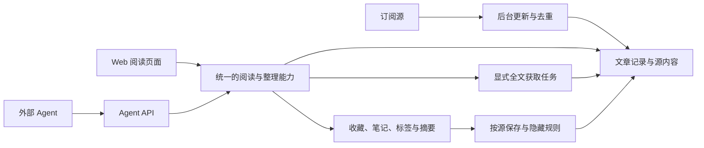

# 产品模块与需求

版本：**已确认的首版需求基线 v1.0，附 2026-10-15 用户明确增补的 R-18**。用户逐步确认核心选择，并最终确认整体产品范围；本轮追加现代 Web 前端要求。工程选择见 [技术选型](technology.md) 与 [架构设计](architecture.md)。首版接口与本机验证已完成，见 [实施验收](implementation.md)；NAS 部署和运行指标尚未验证。

## 产品目标

为开发者本人提供极简、快速、低资源消耗的 Web RSS 阅读器，在现有 NAS 持续运行。每天不定时阅读一次时，内容通常已经自动准备好；抓取异常可见且可恢复。保存有价值的历史，同时让日常页面保持清爽；Agent 可以通过正式接口读取内容、整理与写回结果。

**R-01 已确认：** 单人自用、独立项目、内网或已有 VPN 访问。本人登录，Agent 使用独立 token。兼顾手机浏览器和桌面键盘阅读。

**R-02 已确认：** Agent first 同时涵盖开发协作和产品接口。需求、模块、契约及验收可由 Agent 理解和执行；Agent 接入不依赖模拟点击或数据库私有结构。

## 首版产品模块

下表是用户最终确认的首版范围，界面细节由设计者按极简和阅读效率决定；没有引入尚未选择的技术框架。

| 模块 | 用户能完成什么 | 边界 |
|---|---|---|
| 订阅管理 | 添加/编辑/暂停源、分类、OPML 导入导出、设置更新与保存策略 | 以已有 RSS/Atom/JSON Feed 为输入；无 feed 网站的抓取建源暂不做 |
| 自动更新与源健康 | 后台定期检查；查看成功时间、错误、下次尝试；按需立即刷新 | 不要求打开页面，不因暂时失败永久停更 |
| 收件箱与阅读 | 浏览未读/全部近期文章、按源/分类筛选、读正文、打开原文、批量已读 | 极简列表和阅读页；新文章不打断当前阅读位置 |
| 个人整理 | 收藏、笔记、文章标签，查看 Agent 摘要 | 原文、个人记录、Agent 产物分别可辨认 |
| 归档与搜索 | 查已隐藏文章，按源、日期、状态筛选；搜索仍保存的内容 | 正文已清理时仍可查标题/链接/整理成果，不假装有原文 |
| 生命周期与存储 | 配置可见期限、普通源/长期存档源；查看清理范围 | 隐藏不删除记录；清正文不删整理成果 |
| Agent API | 查询、增量读取、取全文、写摘要，读取任务结果 | 首版不内置自动总结计划或模型依赖 |
| 迁移与维护 | 完整迁入现存 Miniflux 数据、备份恢复、查看应用健康 | 实际迁移和切换仍属于后续实施任务 |

### 模块关系

下图仅表达产品职责；具体进程、技术栈和数据库方案见架构设计：

后台更新负责发现与取得内容；阅读与整理负责用户状态；保存策略负责可见性和内容寿命；API 提供相同能力的外部入口。后续自动总结作为调用方接入，不把模型服务塞入抓取或阅读的必经路径。

## 阅读体验

**R-03 设计方案：** 首页为紧凑的文章列表，以标题、来源、时间、未读状态为主。订阅/分类导航可收起；点击进入专注阅读，返回保留列表位置。手机采用同样的阅读逻辑，不强塞桌面三栏。

常用操作保持直接：标记已读/未读、收藏、打开原文、手动获取全文、查看/写笔记。高级保存策略在源设置中；运行细节集中在源健康页面，不挤入日常阅读。

支持下一篇/上一篇、已读、收藏等键盘操作；使用系统明暗主题和可读的中文排版。新内容到达时更新数量或提供轻提示，避免自动重排正在看的文章。搜索默认范围清晰显示，可显式纳入过期归档。

**R-18 用户增补：** UI 保持简约简洁，同时使用现代 Web 前端技术；利用 Tailwind CSS 统一样式。以组件化、类型检查、响应式布局及流畅阅读交互支持长期维护，不把“极简”理解为只能用原生脚本或服务器模板。具体框架组合见技术选型。

## 更新与全文

**R-04 已确认：** 正常后台检查每 4–6 小时一次；不以分钟级新鲜度作为目标。可按源调整，默认策略优先适合每天阅读一次。

**R-05 设计要求：** 暂时网络、HTTP 或解析失败后，自动退避并继续尝试，展示最近尝试、最近成功、下次尝试及简明原因。源只有被用户明确暂停时才进入人工暂停状态；系统错误不得悄悄伪装成暂停。

更新应错开，限制整体和同站点请求数量，利用条件请求降低重复下载。超时或坏源不阻塞其它源；重启后恢复应做的检查，不重复创建文章。服务器明确限流时遵守其重试提示。手动刷新使用同一抓取流程并合并重复请求。

**R-06 已确认：** 入库保存 RSS/Atom/JSON Feed 提供的正文或摘要。**不自动补抓网页全文**，包括长期存档源。提供文章级“获取全文”按钮和 Agent 调用；操作有进行中、成功、失败状态，失败保留已有内容并可重试。

首版保存取得的文字/HTML内容和相关链接；不默认下载图片、视频、音频或整站快照。只有摘要时如实展示摘要。网站后来删除原文，不会使未取得的正文自动出现。来源只暴露最近若干篇时，不能承诺追回其已经移出的所有历史文章。

## 数据生命周期

**R-07 已确认：** 将页面可见性和内容保存期限分开。文章过期不会改成“已经读过”，不会直接删除文章记录。

| 数据/状态 | 普通源 | 长期存档源 | 收藏文章 |
|---|---|---|---|
| 日常列表，未读 | 首次收录 30 天后隐藏 | 同样按可见期限隐藏 | 免于自动隐藏 |
| 日常列表，已读 | 标记已读 7 天后隐藏 | 同样按可见期限隐藏 | 免于自动隐藏 |
| RSS 正文/摘要、手动取得的全文 | 保留 90 天后清理 | 长期保存已取得内容 | 长期保存已取得内容 |
| 标题、链接、来源、时间、阅读状态 | 继续保存 | 继续保存 | 继续保存 |
| Agent 摘要、个人笔记、标签 | 继续保存 | 继续保存 | 继续保存 |
| 过期后的访问 | 归档/搜索/API 可查；明确说明正文是否还在 | 归档/搜索/API 可查 | 收藏入口与相应查询可查 |

**R-08 已确认：** 用户按源选择普通保存或长期存档，并可调整可见期限；默认已读 7 天、未读 30 天。收藏优先于自动隐藏和正文清理规则。长期存档不自动等于永远显示在首页。

**R-09 已确认：** 普通源正文清理后保留记录和整理成果。RSS 提供的摘要属于源内容，跟随正文清理；Agent 生成并写回的摘要属于整理成果，继续保存。这两种“摘要”不能混为同一字段或同一产品状态。

**R-10 基线设计约定：** 90 天以首次收录时间起算，源的发布时间另存。普通周期重新看到同一文章不能无限延长它的保留期限；正文已清理后也不能每次轮询又自动填回，形成反复写删。普通源显式再次获取成功的正文，从本次取得起另保留 90 天，并明确展示有效期限；保留规则对用户按钮和授权 Agent 请求一致。

源改成长期存档或文章被收藏，保护当前仍保存的正文；对已清理内容只能按用户或 Agent 的明确请求重新获取。切回普通保存或取消收藏后按有效策略处理，界面显示可能的影响。修改保存策略可先预览受影响条数和内容范围。

清理范围包括同份源内容的缓存和搜索索引；否则“清理正文”只是换个地方继续存。归档搜索仍能检索保留的标题、笔记、标签、Agent 摘要。存储中的原文有明确存在/已清理/未获取状态，不以空字符串蒙混。

## Agent 能力

**R-11 已确认：** 首版提供正式 API，使 Agent 能读文章、查归档、显式获取全文、写回摘要。自动运行总结/分析留到后续，不依赖 NAS 本地模型才能使用阅读器。

| 能力 | 产品约定 |
|---|---|
| 查订阅与源健康 | 能识别暂停、失败和调度延后，查最近成功与尝试时间 |
| 读文章/归档 | 明确请求近期、过期或全部；返回稳定标识、来源、正文可用性、阅读与收藏状态 |
| 增量/批量处理 | 能从上次位置继续，处理期间新文章到达不导致悄悄漏项；有分页和请求上限 |
| 获取全文 | 显式创建任务，返回任务状态；重复调用可识别，失败不覆盖已有正文 |
| 写摘要/分析 | 写入独立整理成果，带来源文章、生成者和内容依据；不得覆盖源正文或个人笔记 |
| 重试与并发 | 同一操作重试不重复产生摘要或副作用；冲突有可理解的结果，不静默覆盖 |
| 权限 | token 可区分用途并撤销；读文章、写整理成果、触发抓取可分别控制 |

API 协议、错误结构、分页与幂等机制见 [架构设计](architecture.md)，完整 OpenAPI 契约在实现阶段落盘。首版不预设 MCP 必须是唯一接入方式；如有需要，未来适配器复用同一业务能力。

**R-12 设计要求：** 原始内容、用户笔记和 Agent 产物在界面与接口中明确区分。摘要需能追溯依据；内容更新后保留足以识别摘要对应哪份输入的信息，不要求为了追溯无条件永久保留所有正文版本。

## 迁移

**R-13 已确认：** 迁移当前 Miniflux 的订阅、分类、仍存在的文章、已读状态和收藏。保留来源关联，处理重复导入，不把所有文章重置为未读。手动暂停状态与系统错误状态区分处理。

**R-14 设计要求：** 迁移有预览、计数对账、失败重试和重复执行保护；验证文章样本、关联、已读/收藏数。OPML 不能代替完整数据迁移。未恢复的数据如实列出，不能声称源系统已删除的文章也被迁回。

**R-17 已确认：** 迁入旧正文有 30 天保护期；保护期内不执行正文自动清理，日常列表的隐藏规则照常。保护期后按源策略和原有收录时间处理。重新执行同一次迁移不能反复重置保护期。正常新文章不因此改变 90 天保存期限。

**基线设计约定：** 初始保存策略可以批量设定，默认普通保存，允许在保护期内选长期存档源。正式清理前有可审阅的影响结果。源系统缺失首次收录/已读时间的兜底见架构中的迁移设计，实际字段仍需核验。新旧系统切换时不根据新站“能打开”就清掉旧库。

## 性能、可靠性与维护

**R-15 已确认目标：** 极简、高性能、低功耗，在已有负载的 J1900 / 8 GB NAS 上运行；不因常驻阅读器显著影响下载和媒体服务。

**R-16 设计要求：** 后台并发有界、空闲不忙等、列表分页、搜索有边界；正文处理与阅读请求互不长期阻塞。进程重启后数据、阅读状态、保存设置和待执行任务可恢复。应用提供必要的健康信息及受控日志，不堆积 NAS 临时产物。

量化验收的初始预算（内存、CPU、请求延迟、数据库规模、备份恢复时间）见技术设计；尚待 NAS 实测，不能宣称已达到具体指标。

## 首版验收场景

| 编号 | 场景与可观察结果 |
|---|---|
| A01 | 页面一直关闭，正常源仍按 4–6 小时策略更新；打开后可读新文章，无需手动刷新才能触发后台工作 |
| A02 | 一个源连续失败后恢复，系统能够自动再次抓取；其它源正常更新，错误与成功时间可区分 |
| A03 | 同一文章在多次轮询、任务重试、服务重启后只有同一可追溯记录，已读/收藏状态未丢 |
| A04 | 已读 7 天/未读 30 天文章从日常列表消失，归档可查，阅读状态不被伪造，收藏不自动隐藏 |
| A05 | 普通源正文到保存期限后被清理，标题链接、状态、笔记、标签、Agent 摘要仍在；长期存档源和收藏正文不被清理 |
| A06 | 清理后的文章仍可搜标题和整理成果；源正文及其缓存/索引确已清理，不被下次常规轮询自动填回 |
| A07 | 未点击按钮/调用接口时不抓网页全文；显式获取成功可读，失败保留摘要并显示原因 |
| A08 | Agent 能增量获取文章和过期归档，写摘要且安全重试；撤销 token 后访问失效；摘要不改原文 |
| A09 | 完整迁移后订阅、分类、文章、已读、收藏可对账；重复导入不重复建库，迁移窗口内不意外清理正文 |
| A10 | 手机浏览器可完成订阅浏览、阅读、已读、收藏、搜索；桌面常用操作可用键盘完成 |

## 首版范围外

自动每日总结和模型调用；NAS 本地模型推理；社交分享与推荐；多用户/团队；原生 App 与离线同步；自动全文补抓；全站抓取与媒体文件永久下载；复杂插件市场。新增需求先明确价值、范围与验收，再决定进入哪个阶段。
