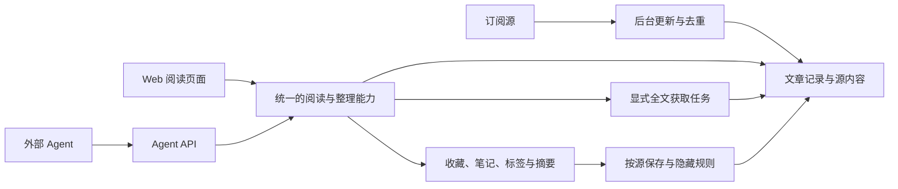

# 产品模块与需求

版本：**已确认的首版需求基线 v1.0，附 R-18 及 2026-10-15 内置 Agent 增补 R-19–R-23**。首版接口与本机验证已完成，内置 Agent 已完成配置、晨报与对话的实现及本机验证，验收范围和质量限制见 docs/implementation.md。工程选择见 [技术选型](technology.md)、[架构设计](architecture.md) 与 [Agent 系统设计](agent-design.md)；NAS已正式部署；完整运行性能/功耗指标仍未验证，见production.md。

## 产品目标

为开发者本人提供极简、快速、低资源消耗的 Web RSS 阅读器，在现有 NAS 持续运行。每天不定时阅读一次时，内容通常已经自动准备好；抓取异常可见且可恢复。保存有价值的历史，同时让日常页面保持清爽；Agent 可以通过正式接口读取内容、整理与写回结果。

**R-01 已确认：** 单人自用、独立项目、内网或已有 VPN 访问。本人登录，Agent 使用独立 token。兼顾手机浏览器和桌面键盘阅读。

**R-02 已确认：** Agent first 同时涵盖开发协作和产品接口。需求、模块、契约及验收可由 Agent 理解和执行；Agent 接入不依赖模拟点击或数据库私有结构。

## 首版产品模块

下表是用户最终确认的首版范围，界面细节由设计者按极简和阅读效率决定；没有引入尚未选择的技术框架。

| 模块 | 用户能完成什么 | 边界 |
|---|---|---|
| 订阅管理 | 添加/编辑/暂停源、分类、OPML 导入导出、设置更新与保存策略 | 以已有 RSS/Atom/JSON Feed 为输入；无 feed 网站的抓取建源暂不做 |
| 自动更新与源健康 | 后台定期检查；查看成功时间、错误、下次尝试；按需立即刷新 | 不要求打开页面，不因暂时失败永久停更 |
| 收件箱与阅读 | 浏览未读/全部近期文章、按源/分类筛选、读正文、打开原文、批量已读 | 极简列表和阅读页；新文章不打断当前阅读位置 |
| 个人整理 | 收藏、笔记、文章标签，查看 Agent 摘要 | 原文、个人记录、Agent 产物分别可辨认 |
| 归档与搜索 | 查已隐藏文章，按源、日期、状态筛选；搜索仍保存的内容 | 正文已清理时仍可查标题/链接/整理成果，不假装有原文 |
| 生命周期与存储 | 配置可见期限、普通源/长期存档源；查看清理范围 | 隐藏不删除记录；清正文不删整理成果 |
| Agent API / 内置 Agent | 首版已有查询、增量读取、取全文、写摘要；本次增补晨报、对话与可配置模型接口 | 新功能按 R-19–R-23 设计，未配置时停用，不影响阅读器 |
| 迁移与维护 | 完整迁入现存 Miniflux 数据、备份恢复、查看应用健康 | 实际迁移和切换仍属于后续实施任务 |

### 模块关系

下图仅表达产品职责；具体进程、技术栈和数据库方案见架构设计：

后台更新负责发现与取得内容；阅读与整理负责用户状态；保存策略负责可见性和内容寿命；API 提供相同能力的外部入口。内置 Agent 通过统一业务能力处理晨报与对话，模型服务不进入抓取或阅读的必经路径。

## 阅读体验

**R-03 已确认，2026-10-16 修订：** 首页默认阅读晨报，完整流程见 R-24。近期文章仍提供紧凑列表，以标题、来源、时间、未读状态为主。订阅/分类导航可收起；点击进入专注阅读，返回保留位置。手机采用同样的阅读逻辑。

常用操作保持直接：标记已读/未读、收藏、打开原文、手动获取全文、查看/写笔记。高级保存策略在源设置中；运行细节集中在源健康页面，不挤入日常阅读。

支持下一篇/上一篇、已读、收藏等键盘操作；使用系统明暗主题和可读的中文排版。新内容到达时更新数量或提供轻提示，避免自动重排正在看的文章。搜索默认范围清晰显示，可显式纳入过期归档。

**R-18 用户增补：** UI 保持简约简洁，同时使用现代 Web 前端技术；利用 Tailwind CSS 统一样式。以组件化、类型检查、响应式布局及流畅阅读交互支持长期维护，不把“极简”理解为只能用原生脚本或服务器模板。具体框架组合见技术选型。

2026-10-15 真实订阅预览后的明确增补：

- 快捷键优先使用不与 Vimium 默认映射及序列前缀冲突的单键；↑/↓直接导航，不加前缀或修饰键。当前分配为 c 侧栏、a 已读、s 收藏、e 原文、q 搜索，Enter 启用聚焦项目，Esc 返回；输入文字、组合输入、弹窗及原生表单控件内不触发阅读操作。侧栏提供按钮和快捷键切换，桌面折叠偏好可保留。此前统一 Alt+Shift 的方案按用户后续反馈撤回。
- 侧栏按实际数据量设计：分类和订阅源分区均可独立展开/收起，标题旁保留管理入口；订阅源折叠时同时收起其筛选框。分类和订阅不能互相挤压到无法显示完整项目；兼顾大量分类/订阅、短窗口和手机。删除装饰性口号和无意义提示，优先保留导航、状态与必要风险说明。
- 列表中的来源名称和图标可点击，进入该源的文章列表；显示来源站点图标，不可用时提供稳定回退。正文利用可用空间，侧栏收起后扩大阅读区，同时保持中文行长可读。
- 分类有明确管理入口，可查询、新建、重命名和删除；分类详情显示其下订阅源，可添加新源、归入已有源、编辑源和移出分类。删除分类将其源移至未分类，保留订阅、文章和阅读状态；移出分类不等于删除订阅。

## 更新与全文

**R-04 已确认：** 正常后台检查每 4–6 小时一次；不以分钟级新鲜度作为目标。可按源调整，默认策略优先适合每天阅读一次。

**R-05 设计要求：** 暂时网络、HTTP 或解析失败后，自动退避并继续尝试，展示最近尝试、最近成功、下次尝试及简明原因。源只有被用户明确暂停时才进入人工暂停状态；系统错误不得悄悄伪装成暂停。

更新应错开，限制整体和同站点请求数量，利用条件请求降低重复下载。超时或坏源不阻塞其它源；重启后恢复应做的检查，不重复创建文章。服务器明确限流时遵守其重试提示。手动刷新使用同一抓取流程并合并重复请求。

**R-06 已确认，2026-10-15 增补：** 入库保存 RSS/Atom/JSON Feed 提供的正文或摘要；普通抓取不自动补抓网页全文，长期存档本身也不触发全文。提供文章级“获取全文”按钮和 Agent 调用。按本次用户明确授权，启用内置 Agent 后，晨报可对**重要源**缺少全文的文章按策略自动补抓，见 R-20；失败保留已有内容，显示状态与实际总结深度。

首版保存取得的文字/HTML内容和相关链接；不默认下载图片、视频、音频或整站快照。只有摘要时如实展示摘要。网站后来删除原文，不会使未取得的正文自动出现。来源只暴露最近若干篇时，不能承诺追回其已经移出的所有历史文章。

## 数据生命周期

**R-07 已确认：** 将页面可见性和内容保存期限分开。文章过期不会改成“已经读过”，不会直接删除文章记录。

| 数据/状态 | 普通源 | 长期存档源 | 收藏文章 |
|---|---|---|---|
| 日常列表，未读 | 首次收录 30 天后隐藏 | 同样按可见期限隐藏 | 免于自动隐藏 |
| 日常列表，已读 | 标记已读 7 天后隐藏 | 同样按可见期限隐藏 | 免于自动隐藏 |
| RSS 正文/摘要、手动取得的全文 | 保留 90 天后清理 | 长期保存已取得内容 | 长期保存已取得内容 |
| 标题、链接、来源、时间、阅读状态 | 继续保存 | 继续保存 | 继续保存 |
| Agent 摘要、个人笔记、标签 | 继续保存 | 继续保存 | 继续保存 |
| 过期后的访问 | 归档/搜索/API 可查；明确说明正文是否还在 | 归档/搜索/API 可查 | 收藏入口与相应查询可查 |

**R-08 已确认：** 用户按源选择普通保存或长期存档，并可调整可见期限；默认已读 7 天、未读 30 天。收藏优先于自动隐藏和正文清理规则。长期存档不自动等于永远显示在首页。

**R-09 已确认：** 普通源正文清理后保留记录和整理成果。RSS 提供的摘要属于源内容，跟随正文清理；Agent 生成并写回的摘要属于整理成果，继续保存。这两种“摘要”不能混为同一字段或同一产品状态。

**R-10 基线设计约定：** 90 天以首次收录时间起算，源的发布时间另存。普通周期重新看到同一文章不能无限延长它的保留期限；正文已清理后也不能每次轮询又自动填回，形成反复写删。普通源显式再次获取成功的正文，从本次取得起另保留 90 天，并明确展示有效期限；保留规则对用户按钮和授权 Agent 请求一致。

源改成长期存档或文章被收藏，保护当前仍保存的正文；对已清理内容只能按用户或 Agent 的明确请求重新获取。切回普通保存或取消收藏后按有效策略处理，界面显示可能的影响。修改保存策略可先预览受影响条数和内容范围。

清理范围包括同份源内容的缓存和搜索索引；否则“清理正文”只是换个地方继续存。归档搜索仍能检索保留的标题、笔记、标签、Agent 摘要。存储中的原文有明确存在/已清理/未获取状态，不以空字符串蒙混。

## Agent 能力

**R-11 已确认，2026-10-15 扩展：** 首版正式 API 使外部 Agent 能读文章、查归档、显式获取全文、写回摘要。本次在此基础上将 Agent 整合为系统模块，新增 R-19–R-23 的晨报、对话、查询与汇报；不依赖 NAS 本地模型，不新增权限体系。

| 能力 | 产品约定 |
|---|---|
| 查订阅与源健康 | 能识别暂停、失败和调度延后，查最近成功与尝试时间 |
| 读文章/归档 | 明确请求近期、过期或全部；返回稳定标识、来源、正文可用性、阅读与收藏状态 |
| 增量/批量处理 | 能从上次位置继续，处理期间新文章到达不导致悄悄漏项；有分页和请求上限 |
| 获取全文 | 显式创建任务，返回任务状态；重复调用可识别，失败不覆盖已有正文 |
| 写摘要/分析 | 写入独立整理成果，带来源文章、生成者和内容依据；不得覆盖源正文或个人笔记 |
| 重试与并发 | 同一操作重试不重复产生摘要或副作用；冲突有可理解的结果，不静默覆盖 |
| 权限 | token 可区分用途并撤销；读文章、写整理成果、触发抓取可分别控制 |

API 协议、错误结构、分页与幂等机制见 [架构设计](architecture.md)，完整 OpenAPI 契约在实现阶段落盘。首版不预设 MCP 必须是唯一接入方式；如有需要，未来适配器复用同一业务能力。

**R-12 设计要求：** 原始内容、用户笔记和 Agent 产物在界面与接口中明确区分。摘要需能追溯依据；内容更新后保留足以识别摘要对应哪份输入的信息，不要求为了追溯无条件永久保留所有正文版本。

### 本次内置 Agent 增补

**R-19 已确认：可配置并可停用。** 接入用户已有的 OpenAI 兼容模型 API；模型、接口等可以配置，未提供时停用 Agent，阅读器照常工作。系统内提供可对话的交互页面，保留报告与对话历史；外部 Agent 可通过接口查询、对话和汇报。按单人自用简化，不新增角色、权限矩阵和逐次授权流程。

**R-20 已确认：完整未读晨报与来源分级。** 每天 Asia/Shanghai 08:00 开始生成，覆盖本次截止时全部未读（含归档）；持续未读次日仍统计，复用未变化的摘要。重要源需全文阅读与总结，只有重要源允许按策略自动补抓全文；次要源可只处理标题、简要或固定截取。按原分类及源的重要度、未读量分组聚合。实际缺文、超预算或未完成时清楚披露，不能只检索几篇却声称已总结全部。

**R-21 已确认：内部引用与生成约束。** 总结的相关段落适当引用文章在本系统的 URL，不用源站 URL 代替。设计可版本化的 system 提示词与结构化格式，区分事实、分析和资料限制；保留文章、依据与摘要的对应关系，系统校验引用和覆盖。

**R-22 已确认目标：大量文章下的查询与效率。** 晨报遍历完整成员集合，对话按问题检索证据；设计分批、层次汇总、缓存复用、预算与恢复机制，并明确 RAG 的应用边界。读取/汇报不自动标已读；正文清理同时覆盖检索片段、临时证据和其他同内容缓存，释义摘要作为整理成果继续保存。

**R-23 已确认工作顺序：** 先提交现有本地未提交改动，再充分调研、重新设计内置 Agent，然后实施；有需要用户取舍的问题主动讨论。旧 API 不等于已经实现本次路线，旧“自动总结留待以后”的边界按本次需求更新。

**R-24 已确认：晨报为日常阅读首页。** “晨报 · Agent”与近期文章、收藏、归档同列在主侧栏，首页默认打开晨报。点击报告中的内部文章引用进入正文，阅读后用“返回晨报”或 Esc 回到同一报告、原引用及滚动位置；刷新或新标签打开仍可依 URL 找回引用。提供一键把当前晨报已总结文章标为已读，范围以固定报告成员及实际卡片为准，覆盖多页和归档；新到文章、待处理、不可用和只有格式失败提示的成员不在操作范围内。正常降级但存在实质摘要的成员仍算已总结。报告执行中不执行批量已读，避免范围变化；请求可幂等重试。

**R-25 已确认：晨报阅读细节与页内提问。** “总结文章标为已读”位于报告正文末尾。处理范围、缺文、聚合失败等运行说明收为简短入口，鼠标悬停、键盘聚焦或手机点击可查看详细技术报告，说明统计语义、固定成员/已读判定、处理阶段和实际已记录的错误；未知原因明确未知，不编造旧报告诊断。围绕报告提问留在当前晨报，桌面右侧、窄屏底部展开，关闭后继续原报告，关联会话可复用。统一晨报、对话、近期/归档/收藏及设置的间距、字号、颜色和明暗主题可读性，不改变既有键盘约定。

**R-26 已确认：侧栏源异常与分类展开。** 订阅源橙色异常点可悬停、聚焦或点击查看服务记录的具体错误、可解释的原因、最近尝试/成功及重试时间；已暂停时显示暂停状态，不承诺自动重试。每个分类有独立展开箭头，显示当前属于它的订阅源，子源可直接导航，异常提示与全局订阅列表一致。点击分类名称继续按分类查看文章；分类分区、各分类与订阅源分区独立收起，展开本身不切换阅读视图，空分类有明确提示。

**R-27 已确认：新文章优先与侧栏未读数。** 近期、归档、收藏、搜索及按源/分类筛选的文章列表统一按发布时间倒序；没有发布时间时用首次收录时间，同一时刻用文章ID倒序，翻页保持一致。侧栏全局及分类下的订阅源显示非零未读数，统计包含隐藏归档、排除已读和removed，不受当前筛选或已加载页数限制；更新列表、单篇已读/未读、本页已读与整份晨报已读后同步刷新，归零隐藏。

**当前工程实现（参数为可配置初值）：** 重要/普通/次要三级且默认普通；普通 3,000 字符、次要 500 字符输入初值；全集快照、确定工作流、单模型执行槽、日预算、局部失败报告；先词法 RAG，语义向量/重排经实测再增强。自动补抓不反复恢复已清理正文或延长原有保留时钟。完整取舍、提示词、接口草案与实施阶段见 [Agent 设计](agent-design.md)、[调研](agent-research.md)、[提示词](agent-prompts.md)。

## 迁移

**R-13 已确认：** 迁移当前 Miniflux 的订阅、分类、仍存在的文章、已读状态和收藏。保留来源关联，处理重复导入，不把所有文章重置为未读。手动暂停状态与系统错误状态区分处理。

**R-14 设计要求：** 迁移有预览、计数对账、失败重试和重复执行保护；验证文章样本、关联、已读/收藏数。OPML 不能代替完整数据迁移。未恢复的数据如实列出，不能声称源系统已删除的文章也被迁回。

**R-17 已确认：** 迁入旧正文有 30 天保护期；保护期内不执行正文自动清理，日常列表的隐藏规则照常。保护期后按源策略和原有收录时间处理。重新执行同一次迁移不能反复重置保护期。正常新文章不因此改变 90 天保存期限。

**基线设计约定：** 初始保存策略可以批量设定，默认普通保存，允许在保护期内选长期存档源。正式清理前有可审阅的影响结果。源系统缺失首次收录/已读时间的兜底见架构中的迁移设计，实际字段仍需核验。新旧系统切换时不根据新站“能打开”就清掉旧库。

## 性能、可靠性与维护

**R-15 已确认目标：** 极简、高性能、低功耗，在已有负载的 J1900 / 8 GB NAS 上运行；不因常驻阅读器显著影响下载和媒体服务。

**R-16 设计要求：** 后台并发有界、空闲不忙等、列表分页、搜索有边界；正文处理与阅读请求互不长期阻塞。进程重启后数据、阅读状态、保存设置和待执行任务可恢复。应用提供必要的健康信息及受控日志，不堆积 NAS 临时产物。

量化验收的初始预算（内存、CPU、请求延迟、数据库规模、备份恢复时间）见技术设计；尚待 NAS 实测，不能宣称已达到具体指标。

## 首版验收场景

| 编号 | 场景与可观察结果 |
|---|---|
| A01 | 页面一直关闭，正常源仍按 4–6 小时策略更新；打开后可读新文章，无需手动刷新才能触发后台工作 |
| A02 | 一个源连续失败后恢复，系统能够自动再次抓取；其它源正常更新，错误与成功时间可区分 |
| A03 | 同一文章在多次轮询、任务重试、服务重启后只有同一可追溯记录，已读/收藏状态未丢 |
| A04 | 已读 7 天/未读 30 天文章从日常列表消失，归档可查，阅读状态不被伪造，收藏不自动隐藏 |
| A05 | 普通源正文到保存期限后被清理，标题链接、状态、笔记、标签、Agent 摘要仍在；长期存档源和收藏正文不被清理 |
| A06 | 清理后的文章仍可搜标题和整理成果；源正文及其缓存/索引确已清理，不被下次常规轮询自动填回 |
| A07 | 普通抓取不访问文章网页；显式获取成功可读、失败保留摘要；本次重要源晨报自动补抓例外另由 A12/A18 验证，不倒写成已通过 |
| A08 | Agent 能增量获取文章和过期归档，写摘要且安全重试；撤销 token 后访问失效；摘要不改原文 |
| A09 | 完整迁移后订阅、分类、文章、已读、收藏可对账；重复导入不重复建库，迁移窗口内不意外清理正文 |
| A10 | 手机浏览器可完成订阅浏览、阅读、已读、收藏、搜索；桌面↑/↓直接导航，其余操作优先使用不与Vimium默认映射冲突的单键，输入/弹窗不误触；侧栏可收起且大量分类/源不挤压导航；来源链接/图标和分类管理可用，删除分类保留其源与文章 |

## 内置 Agent 待执行验收

| 编号 | 场景与可观察结果（尚未实施/验证） |
|---|---|
| A11 | 模型未配置或停用时无模型调用、自动全文任务和 Agent 索引构建；阅读/原 API 可用，历史报告仍可查 |
| A12 | 08:00 固定全部未读快照，含归档；重要源完整正文按全部块处理，普通/次要按所设深度；无法全文读取明确 partial |
| A13 | 原分类与来源可辨，重要度及未读量影响详略；重复报道可合并而成员不丢；每段引用打开内部文章，生成/浏览不改阅读状态 |
| A14 | 持续未读隔日仍计数，hash/策略未变化时复用卡片；来源分类调整重聚合，正文变化/重要度升级不能错误复用浅摘要 |
| A15 | 重启、重复tick、断网/429/超时、旧worker迟到、取消/重试下唯一发布；步骤可续作，未知远程用量如实计入，无重复报告 |
| A16 | 对话查文章、精确数量/源健康、追问报告，无答案/证据冲突可解释；外部查询/对话/汇报共用规则及结构化校验，不增加 Agent 权限体系 |
| A17 | 2,000/10,000 未读与长文有界处理，全部成员状态可核对；预算不足生成部分报告与缺口表，不把top-k冒充全量，不影响源正常更新 |
| A18 | 重要源补抓不会无限复活已清理正文；到期后工具/历史片段/索引/向量均不能继续泄出原文，释义报告和文章元数据保留 |
| A19 | 提示词注入、伪造ID/URL、跨文章依据、截断/拒答无法绕过格式/引用校验；语义支持与摘要遗漏另做金标准及人工质量验收 |

## 当前范围外

NAS 本地模型推理；社交分享与推荐；多用户/团队；原生 App 与离线同步；重要源晨报策略以外的默认全文补抓；全站抓取与媒体文件永久下载；复杂插件市场。自动每日总结和模型 API 已由 R-19–R-23 纳入本次增补并已实现。系统外消息推送未在本次要求中，报告先在系统内发布。
